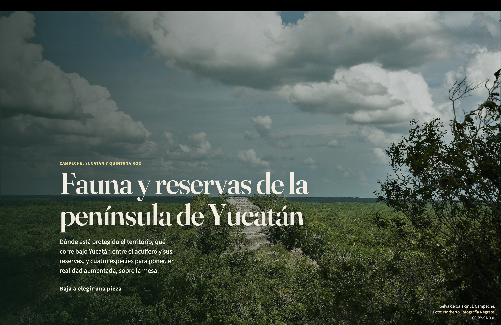
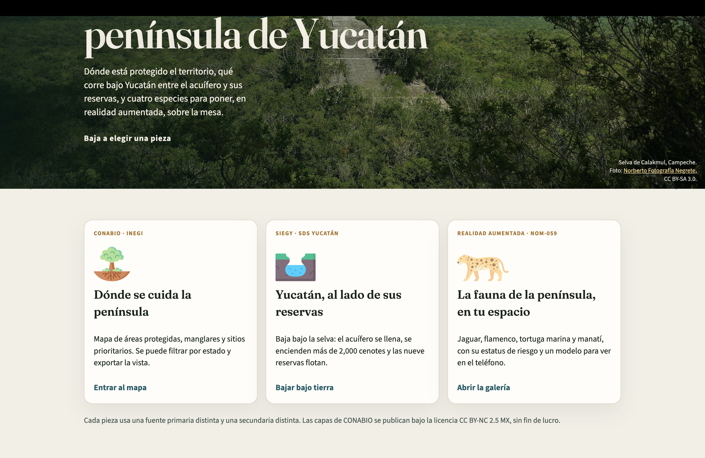
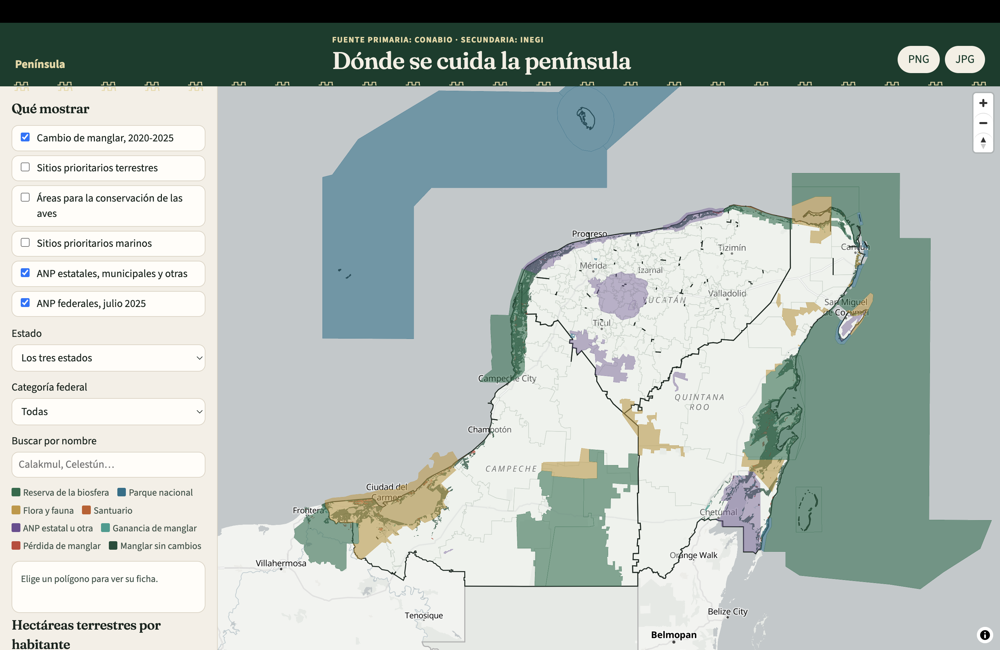
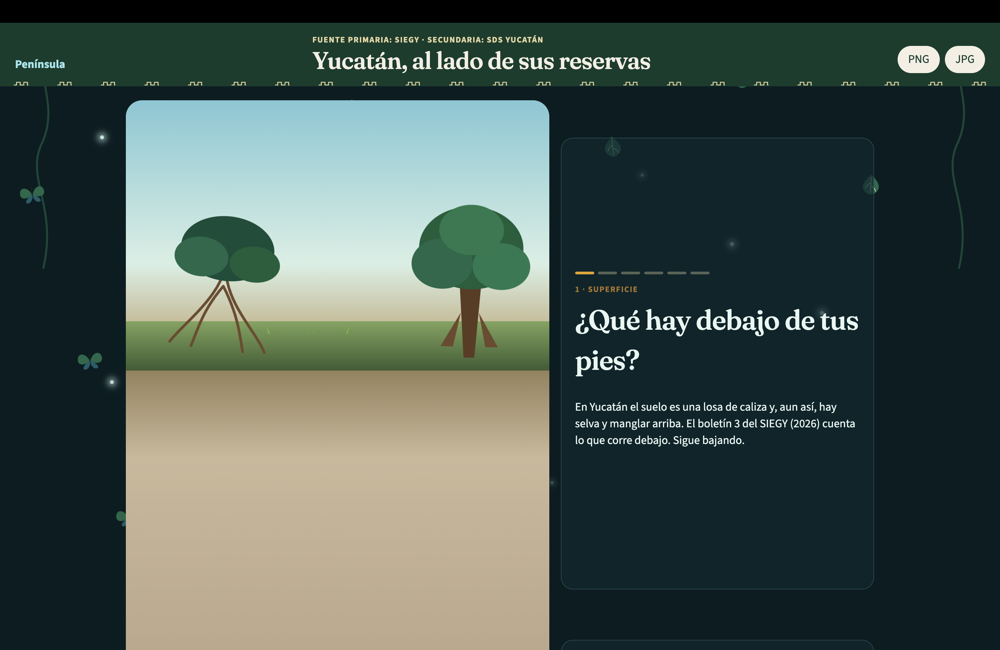
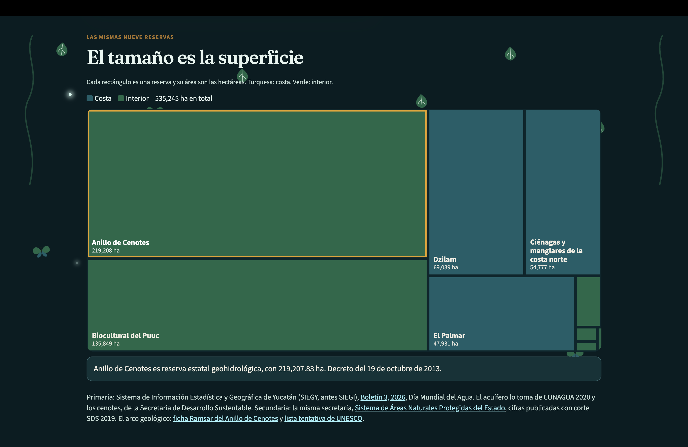
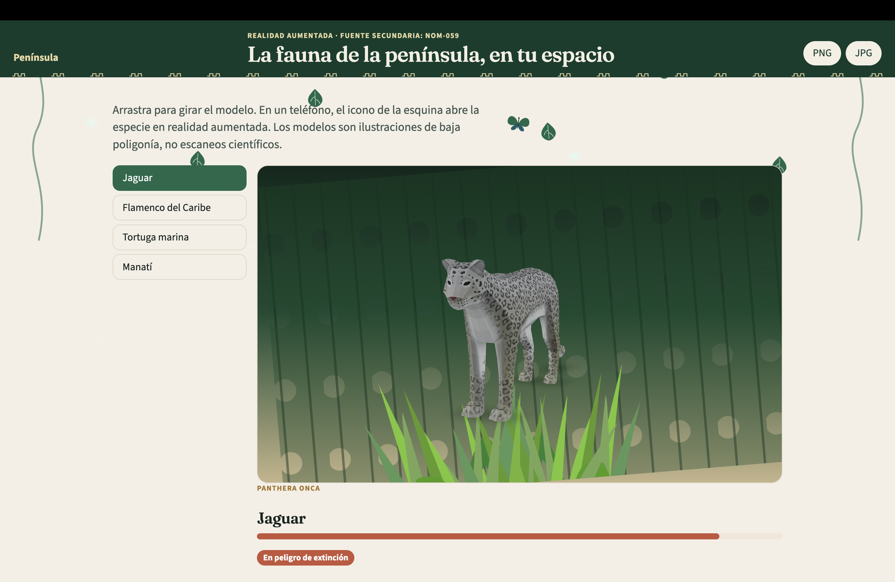
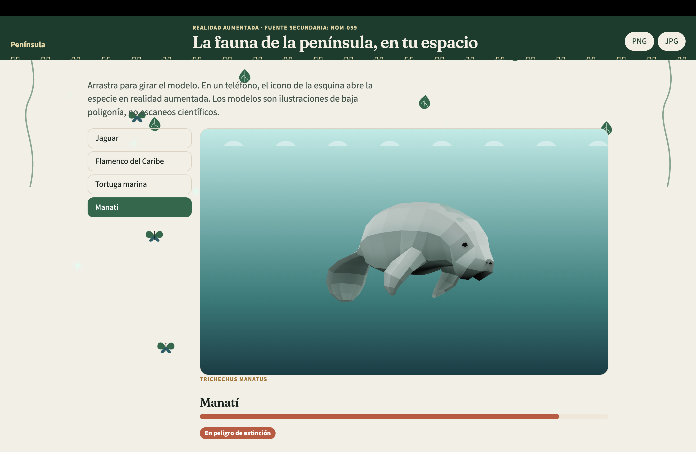

# Fauna y reservas de la península de Yucatán

Campeche, Yucatán y Quintana Roo. Tres piezas leen la misma base MongoDB `datos`: un mapa, un recorrido del SIEGY y una galería en realidad aumentada.

Las capas de CONABIO se publican bajo la licencia CC BY-NC 2.5 MX, sin fin de lucro.

## Capturas

### Portada





### Dónde se cuida la península



### Yucatán, al lado de sus reservas





### La fauna de la península, en tu espacio





## Cómo correrlo

Hace falta Docker. Los CSV y GeoJSON van en `datos/` en esta máquina: no se suben al repositorio. Al arrancar, el contenedor los carga en Mongo.

```bash
docker compose up --build
```

El sitio queda en [http://127.0.0.1:8000](http://127.0.0.1:8000).

| Pieza | Ruta |
| --- | --- |
| Portada | `/` |
| Dónde se cuida la península | `/mapa/` |
| Yucatán, al lado de sus reservas | `/siegy/` |
| La fauna de la península, en tu espacio | `/ar/` |

Si Mongo ya tiene capas, el arranque no vuelve a cargar `datos/`. Para repetir la carga: `FORCE_CARGA=1`.

Antes de cargar, en local:

```bash
python etl/validar_datos.py
```
